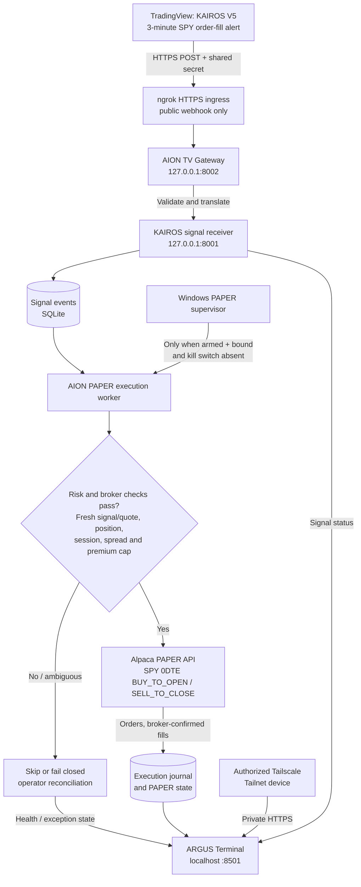
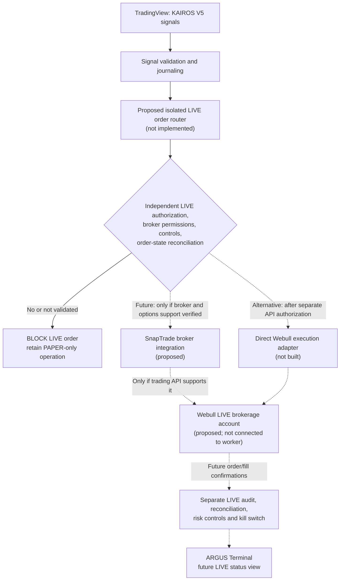

# ARGUS Terminal — AION's Live Trading Monitor

**ARGUS (AION LTM)** is the private, Windows-hosted monitoring and control terminal for **AION Quant Labs**. It observes 3-minute SPY strategy alerts from [**KAIROS — Lorentzian ML Swing Engine**](https://github.com/woi-6ix/KAIROS-Lorentzian-ML-Swing-Engine_JXS), signal ingestion, execution state, broker-confirmed fills, system health, protected PAPER trade controls, historical backtesting, stock screening, headline sentiment and market-regime research. The implemented automated order route is **Alpaca PAPER only**, with a **$2,500 maximum option-premium debit per entry**; no live brokerage order path is deployed yet.

> **Deployment snapshot — November 10, 2026:** ARGUS is operating locally on the owner's Windows machine. The dashboard and other AION services have been launched as background scheduled tasks; ngrok has been migrated to an automatically starting Windows service. PAPER entry/exit orders have been tested previously, but automated operation remains experimental and requires monitoring. A temporary Alpaca account-API connection failure overnight on November 10 stopped the PAPER worker and activated its kill switch; it was manually reconciled and rearmed later. Do **not** infer worker health, current arming, or live orders from this dated README: inspect the local heartbeat and Alpaca broker account directly.

## Why is it called ARGUS?

**Argus Panoptes** ("all-seeing Argus") is the watchful guardian of Greek mythology, often depicted with a hundred eyes. The name reflects the terminal's role: **observe every signal, execution, account state and infrastructure warning without mistaking a signal for a filled trade**. ARGUS is the *watchtower*; [**KAIROS**](https://github.com/woi-6ix/KAIROS-Lorentzian-ML-Swing-Engine_JXS) is the strategy that identifies trading opportunities; **AION Quant Labs** is the parent organization. The existing official circular AION logo is retained, and existing `aion_*` filenames remain unchanged to avoid breaking services, task registrations and API paths.

| Brand | Role |
| --- | --- |
| **AION Quant Labs** | Parent quant research and algorithmic trading organization |
| **[KAIROS](https://github.com/woi-6ix/KAIROS-Lorentzian-ML-Swing-Engine_JXS)** | SPY 3-minute ML strategy and TradingView alert source |
| **ARGUS Terminal** | Tailnet-restricted monitoring, research, diagnostics and authenticated Alpaca PAPER operator controls |

## System overview

| Component | Default | Purpose |
| --- | --- | --- |
| `aion_kairos_server.py` | `127.0.0.1:8001` | KAIROS V5 signal simulator; SQLite event tracking |
| `aion_tv_gateway.py` | `127.0.0.1:8002` | Authenticates TradingView alerts, relays to simulator |
| `aion_live_dashboard.py` | `127.0.0.1:8501` | ARGUS-branded monitoring and research base app |
| `aion_ltm_with_controls.py` | `127.0.0.1:8501` | ARGUS website wrapper with token-protected PAPER position controls and pause/resume |
| `aion_backtest_engine/` | mounted at `/lab/` | Stock/0DTE historical backtesting and CSV imports |
| `aion_alpaca_paper_panel.py` | mounted at `/alpaca-paper/` | Read-only options chain/chart & paper status |
| `aion_alpaca_paper_algo.py` | supervised worker process | **Alpaca PAPER** SPY 0DTE limit orders from accepted signals |
| `aion_paper_supervisor.py` | `AION-Alpaca-Paper-Supervisor` scheduled task | Starts the worker only when armed, account-bound and not kill-switched; no automatic re-arm after failure |
| `aion_ltm_background.py` | `AION-LTM-Dashboard` scheduled task | Serves ARGUS without keeping a terminal or browser tab open |
| ngrok v3 Windows service | Automatic Windows service → `127.0.0.1:8002` | Public HTTPS ingress for authenticated TradingView POSTs **only** |
| Tailscale Serve | Tailnet-only HTTPS → `127.0.0.1:8501` | Private VPN-like access to ARGUS from approved Tailnet devices |
| `aion_execution_journal.py` | local SQLite | Only broker-confirmed option fills, P&L journal |
| `aion_research.py` | `/api/research/` routes | Daily-close stock/ETF screener, Google News RSS + VADER headline sentiment, optional HMM/GARCH and STORM-style regime research |

## ARGUS Terminal features

ARGUS brings together algorithmic signal monitoring, a **password-style locked Alpaca PAPER control panel**, market research, backtesting and system diagnostics in one private web interface. The components below are implemented in the current source unless explicitly described as a separate project or future integration.

| Feature | What the operator can do | Data / execution boundary |
| --- | --- | --- |
| **Password-style locked Alpaca PAPER controls** | Unlock a floating control panel; inspect broker positions and worker health; manually pause/resume PAPER automation; request position close or account-wide close/cancel | Authenticated PAPER-only actions, not Webull or Alpaca LIVE |
| **KAIROS signal logging and execution tracking** | Inspect recent TradingView alerts, entry/exit/reversal intent, execution mode, confirmed fills and P&L journal | Signal acknowledgment is **not** an order or fill |
| **Integrated backtesting lab** | Download/cache/import OHLCV, run KAIROS core-port stock-bar studies, import Strategy Tester trades/Pine signals, and replay 0DTE options against historical quotes | Backtests are research only; not Pine-parity or guaranteed execution |
| **Financial stock & ETF screener** | Edit a watchlist, scan technical metrics, inspect directional trend labels, and chart historical closing prices | Yahoo/yfinance **daily historical** data, not live licensed market-wide screening |
| **News and sentiment analyzer** | Retrieve ticker-related news headlines, view per-headline sentiment and an aggregate sentiment score | **VADER lexical analysis** of Google News RSS headlines, not FinBERT |
| **Market Regime Lab** | Explore HMM regime labels, GARCH volatility estimates and STORM-style signals | Optional research fits and a heuristic proxy, not the original production STORM |
| **System health and audit views** | Review local service status, KAIROS receiver state, worker heartbeat/supervisor, armed/kill-switch status and broker-confirmed activity | Task status alone cannot prove an active worker or filled trades |

### Locked Alpaca PAPER control panel

The floating **ALPACA PAPER CONTROLS** interface is integrated into ARGUS through \`aion_ltm_with_controls.py\`, \`aion_alpaca_controls.js\` and \`aion_alpaca_control.py\`.

- A **masked password-style input** lets the operator enter a separate, long random **\`AION_CONTROL_TOKEN\`** and choose **Unlock**. The backend validates the token sent in the \`X-Aion-Control-Token\` header before disclosing PAPER positions or allowing control actions. This is a **shared control token, not a separate username/password login system**; ARGUS itself must remain restricted to the private Tailscale Tailnet. The token lives outside Git and is held in browser memory rather than embedded in JavaScript or stored permanently in the browser.
- After unlocking, the panel shows **PAPER bot state, recent/stale heartbeat, Windows supervisor mode, broker connectivity, open positions, market values and unrealized P&L**. The interface distinguishes **armed permission** from a **confirmed running worker**.
- **Pause automation** disarms; **Resume automation** re-arms only after the worker's existing account/order safety checks and lets the supervisor launch the worker. Actions require deliberate confirmation. **Pausing does not automatically flatten positions and may stop automatic exits.**
- The operator can request **Close** for an individual PAPER position, or **CLOSE ALL PAPER POSITIONS + CANCEL ORDERS** for the entire PAPER account. Manual closes disarm the worker first. Submission is **not proof of a fill**; verify at Alpaca. An account-wide close affects **all** holdings in that PAPER account, not just KAIROS.

Access to the site uses **Tailscale Serve over an authorized Tailnet**; the control token adds an application-level gate for sensitive PAPER operations. See [PAPER controls](README_AION_LTM_PAPER_CONTROLS.md) and [persistent local token](README_AION_LTM_PERSISTENT_TOKEN.md). Never publish the token or the dashboard through the public TradingView webhook.

### TradingView signal logging, broker fills and monitoring

[**KAIROS**](https://github.com/woi-6ix/KAIROS-Lorentzian-ML-Swing-Engine_JXS) emits 3-minute SPY TradingView strategy alerts. The authenticated port-8002 gateway validates supported V5 messages and forwards them to the local port-8001 receiver, which durably writes **timestamped SQLite events** such as \`SIGNAL_LOGGED\`, \`EXIT_INTENT_LOGGED\`, \`REVERSAL_INTENT_LOGGED\`, duplicates and ignored signals. ARGUS presents a recent activity chart, an alert history and execution status. The supervised worker separately records **PAPER order decisions** (for example a submitted entry, stale skip, rejected condition or halted error). Its execution journal records **broker-confirmed fills and derived P&L**, not hypothetical fills from TradingView.

A TradingView \`HTTP 200\` confirms only the ingress/receiver handoff. The operator must check the worker PID, **fresh heartbeat**, kill switch, local decision record, Alpaca orders and actual fills before concluding a trade occurred. This distinction is central to ARGUS's "all-seeing" name.

### Financial stock and ETF screener

The **Stock Screener** is an editable **up-to-12-symbol** watchlist, with common defaults such as SPY, QQQ, IWM, DIA, AAPL, MSFT and NVDA. ARGUS retrieves approximately **three months of daily Yahoo Finance/yfinance history** for the selected stocks/ETFs, then computes:

- Last closing price and daily percentage change, **14-period RSI**, **20/50-period EMAs**, relative volume versus a recent 20-session baseline, and **20-day annualized realized volatility**.
- A simple **BULLISH**, **BEARISH** or **MIXED** trend designation based on close-price alignment with its 20/50 EMAs.
- A selectable daily-close price chart for visual review; returned bars and the 10-minute research cache reduce repeat fetching.

This is a **user-specified historical watchlist screen**, not a full-universe stock scanner, real-time broker quote service, licensed commercial market-data feed or direct trade signal.

### News sentiment: current ARGUS VADER analyzer and linked IRIS FinBERT project

**Currently in ARGUS:** Enter a research ticker under **News & Sentiment**. The terminal searches **Google News RSS** for recent ticker-related finance headlines, retrieves up to 15 relevant feed entries, and applies the **VADER** lexical sentiment analyzer to each **headline only**. Each result receives a compound sentiment score (approximately **−1 to +1**), a **Positive / Neutral / Negative** label, article metadata/link, and an aggregate average sentiment measure. ARGUS caches headline research for roughly 10 minutes. This lightweight indicator is keyword-dependent, can miss financial context, does not read full article bodies, and **is not FinBERT**.

**Related standalone project — [IRIS FinBERT Stock Financial Sentiment Console](https://github.com/woi-6ix/IRIS_FinBERT_Console_JXS):** IRIS is the separate Streamlit NLP and forecasting application developed by the same author. Its published implementation describes the following pipeline:

1. The user selects a stock **ticker and keyword**; IRIS retrieves **Yahoo Finance price history** plus related **Yahoo Finance RSS news** and filters matched article titles/summaries by keyword.
2. Hugging Face's **[FinBERT (\`ProsusAI/finbert\`)](https://huggingface.co/ProsusAI/finbert)** classifies financial news text as **positive, neutral or negative**, and converts classification results to signed sentiment scores. News dates are aligned to the current or next trading day.
3. IRIS combines those sentiment values with historical **daily returns and moving-average features**. **XGBoost regression** uses lagged return and sentiment features to produce research-only return forecasts across a user-selected business-day horizon.
4. The console visualizes **sentiment distributions, price/return moving averages, forecast charts, MAE/RMSE evaluation metrics and feature importance** for interpretation.

**Integration status:** This FinBERT + XGBoost pipeline belongs to **IRIS** and is **not currently wired into ARGUS's \`aion_research.py\` sentiment endpoint**. Connecting IRIS/FinBERT to ARGUS is a possible future upgrade; it must not be presented as already deployed or as a validated automated trading signal. See the [IRIS repository and methodology](https://github.com/woi-6ix/IRIS_FinBERT_Console_JXS).

### Integrated KAIROS backtesting and 0DTE quote replay

The **Backtesting** tab embeds the original Quant Terminal research engine under \`/lab/\` and provides:

- **Stock-bar history:** select ticker, timeframe, historical window and a supported data source; download/cache OHLCV from Yahoo/yfinance where available, use a separately configured market-data provider, import **OHLCV CSV**, or ingest a **separately authorized TradingView OHLCV sync**. A connected ChatGPT TradingView account **does not automatically grant** the local website historical-data access.
- **KAIROS core-port stock strategy:** run an executable, research-only **KAIROS V5 CORE PORT** approximation on stock bars, inspect trade tables, equity results, diagnostics and the saved backtest library. **It is not an exact Pine strategy replica**: LC/ML, full environment/HMM gates and kernel parity are not verified. Imported TradingView Strategy Tester trades are needed for faithful records of the original Pine strategy.
- **Signal and trade imports:** import Pine entry/exit timestamps as CSV and **TradingView Strategy Tester CSV**; organize historical runs and inspect completed trades and calculated performance metrics.
- **Historical 0DTE options replay:** use core-port signals or imported signal timestamps, choose supported underlyings (SPY/QQQ/IWM), and replay option entry/exit against **actual timestamped historical bid/ask quote records**, with configurable quantities, fees, slippage, quote staleness and exit mode. Missing option quotes **skip trades** rather than fabricating results.

Backtesting does **not** drive live trading or place Alpaca PAPER orders. Historical quote availability depends on the provider's data-entitlement and source coverage. Stock-bar backtests cannot be interpreted as historical 0DTE options profit.

### Regime and volatility research

The **Market Regime Lab** uses daily historical returns to fit a **three-state Gaussian HMM** (when \`hmmlearn\` is installed) and an optional **GARCH(1,1)** next-day conditional volatility estimate (when \`arch\` is installed). It also presents a **STORM-style heuristic proxy** built from 20-day momentum and realized volatility. The proxy is **not the original STORM model** and these research metrics are not wired into the PAPER worker's execution gates.


## Access model — Tailnet-restricted ARGUS, separate public webhook

**ARGUS dashboard access is private:** the website listens on **localhost port 8501**. The operator reaches it locally or through **Tailscale Serve over the private Tailnet**, which requires an authenticated device/user with Tailnet access (subject to Tailnet ACLs). The Tailnet hostname is intentionally not published here. The ARGUS operator's PAPER controls also require the separate `AION_CONTROL_TOKEN` stored locally outside this public repository. Neither the dashboard nor its control API should be published via the public ngrok tunnel.

**The TradingView webhook is *not* VPN-only.** A separate ngrok HTTPS endpoint exposes **only the TradingView gateway on port 8002** to allow TradingView's external servers to deliver strategy alerts. The gateway checks the JSON shared secret, strategy, symbol, timeframe, action and timestamp, then forwards accepted events to the **localhost-only** receiver on port 8001. Its HTTP 200 acknowledgment means *the signal was received*, not that an options order was sent or filled. A shared secret alone does not authenticate the actual sender; rotate compromised secrets and add hardened origin controls before considering real-money execution.

| Network surface | Exposure | Authorization / purpose |
| --- | --- | --- |
| ARGUS `:8501` | Localhost + Tailscale Tailnet only | Tailnet membership/ACLs; PAPER control actions additionally require `AION_CONTROL_TOKEN` |
| KAIROS receiver `:8001` | Localhost only | Signal database/event-state engine; **no** brokerage submission |
| TradingView gateway `:8002` | Localhost; public through ngrok HTTPS | Shared-secret authenticated POST `/tv-webhook`; **not** a dashboard/VPN endpoint |
| Alpaca API | Outbound HTTPS from PAPER worker only | Local PAPER credentials; hard-coded `paper-api.alpaca.markets` for trading |
| SnapTrade / Webull LIVE | **Not enabled** | Future architectural integration only; no live orders in this repo |

## Workflow A — implemented KAIROS → Alpaca PAPER



**Implemented safeguards:** explicit arming and an independent kill switch, account binding, duplicate-worker locking, broker reconciliation and deterministic order IDs, a **55-second signal freshness limit**, indicative-quote freshness of **120 seconds**, maximum option spread of **$0.40 and 35%** of ask, **$2,500 total premium per entry** and **25 contracts maximum**, **09:31–14:45 ET** entry window (14:45 exclusive), EXIT processing through **15:02 ET**, and a **14:45 ET attempted emergency close**. A failed or unknown submission must be investigated; the 14:45 attempt is not guaranteed to fill. No verified daily loss cap is implemented. Trading is PAPER-only; simulated fills are not evidence of real execution quality.

## Workflow B — proposed SnapTrade / Webull LIVE architecture (NOT DEPLOYED)



**This is a roadmap diagram, not an enabled broker connection.** SnapTrade may provide brokerage connectivity, but **Webull account linking, 0DTE option order placement, account entitlements, supported order types and live execution permissions must be confirmed**. Do not assume SnapTrade can route Webull options orders or that a TradingView/Webull plugin is a production broker gateway. Any LIVE adapter must be isolated from the existing PAPER worker, require a separate explicit enablement and identity verification, and add tested position limits, daily loss limits, idempotency, broker/market data validation, audit logging, emergency exits and recovery procedures. **No live brokerage credentials or endpoints are wired into the current execution path.**


## Quick start (Windows PowerShell)

```powershell
cd C:\Users\sathw\AION-Execution
# Clone into a NEW, CLEAN directory instead if you already run AION locally.
.\.venv\Scripts\python.exe -m pip install -r .\requirements-aion.txt
.\.venv\Scripts\python.exe -m pip install -r .\requirements-aion-unified.txt
.\.venv\Scripts\python.exe -m pip install -r .\requirements-alpaca-paper-algo.txt
```

Copy `.env.example` to a local `.env` and fill in **paper-only** API credentials. Never overwrite an existing working `.env` or upload credentials. **The following manual commands are for a new development setup, not the currently deployed background configuration.** On the operator's Windows machine, the receiver, gateway, ARGUS dashboard and PAPER supervisor already use independent Task Scheduler tasks, and ngrok uses a Windows service; do not launch second copies on the same ports:

```powershell
# Terminal 1: KAIROS signal engine (local)
.\.venv\Scripts\python.exe -m uvicorn aion_kairos_server:app --host 127.0.0.1 --port 8001
# Terminal 2: authenticated TradingView gateway (local)
.\.venv\Scripts\python.exe -m uvicorn aion_tv_gateway:app --host 127.0.0.1 --port 8002
# Terminal 3: unified AION dashboard + PAPER-only controls (local)
.\start_aion_ltm_controls.ps1
```

Local ARGUS dashboard: `http://127.0.0.1:8501/` · Backtests: `http://127.0.0.1:8501/lab/` · Options panel: `http://127.0.0.1:8501/alpaca-paper/`. Remote monitoring is available only to authorized Tailscale Tailnet devices.

**Important:** Startup scripts and package upgrades are maintained for Windows convenience; do not run the historical installer scripts indiscriminately over an already working installation. See `docs/INSTALL_WINDOWS.md` before migrating an existing `AION-Execution` folder.

## Alpaca Paper worker

The worker is **separate** from the read-only dashboard. It is designed to use `https://paper-api.alpaca.markets` for every order operation; it does not submit to Alpaca Live, SnapTrade, Webull CASH or Webull MARGIN.

```powershell
.\.venv\Scripts\python.exe .\aion_alpaca_paper_algo.py check     # read-only paper account check
.\.venv\Scripts\python.exe .\aion_alpaca_paper_algo.py chain     # fetch today's SPY options quotes
.\.venv\Scripts\python.exe .\aion_alpaca_paper_algo.py status    # arm/kill status
.\.venv\Scripts\python.exe .\aion_alpaca_paper_algo.py disarm    # disable NEW paper entries
```

When validating options data, `.\.venv\Scripts\python.exe .\aion_alpaca_paper_algo.py chart --symbol <OCC_SYMBOL>` requests 3-minute historical option bars. On Alpaca's free options market-data plan, historical candles can lag real time; quotes are *indicative*, not OPRA-quality consolidated prices.

**Trading behavior:** KAIROS V5 LONG and SHORT alert fills select SPY 0DTE calls/puts; sizing floors the number of contracts under a **$2,500 total premium-debit cap** (25-contract secondary limit). Real KAIROS V5 exit, kernel-flip, reversal and session-cutoff alerts control closes; the old +30%/−25% premium exits have been removed. A separate 14:45 ET failsafe still attempts a close. See [KAIROS V5 $2,500 Paper Upgrade](README_AION_KAIROS_V5_2500_PREMIUM.md).

**Automated trading requires explicit user action:** `arm`, then `run`. Do not arm without successful tests of quote freshness, account permissions, order reconciliation, exit handling and webhook origin security. `disarm` prevents new entries but **does not cancel resting orders or close existing paper positions**. `AION_MODE=SIMULATION` is intentional even for the Alpaca Paper worker. The worker processes accepted events from the local simulator, not from the dashboard browser.

## ARGUS Terminal — Alpaca PAPER manual controls (opt-in)

**Stable token startup:** Launch port 8501 with `start_aion_ltm_controls.ps1` instead of manually regenerating `AION_CONTROL_TOKEN`. The script keeps a per-user secret under `%LOCALAPPDATA%\AION\ltm-control-token.txt`, copies it to the clipboard, and prevents a second server from occupying the port. After a browser refresh, recopy the same secret with `Get-Content "$env:LOCALAPPDATA\AION\ltm-control-token.txt" -Raw | Set-Clipboard`. See [persistent token guide](README_AION_LTM_PERSISTENT_TOKEN.md). This changes dashboard authentication only and does not place orders.


The `aion_ltm_with_controls.py` wrapper retains the ARGUS-branded dashboard UI, original AION Quant Labs logo, `/lab/` backtesting and read-only `/alpaca-paper/` charts. It adds authenticated `/api/alpaca-control/` endpoints and a floating control panel to pause (disarm), resume (arm), close a selected PAPER position, or request account-wide PAPER position liquidation. This is **PAPER ONLY**; no live-trading API host or trade credentials are included in browser code.

**Installation:** See [AION LTM manual controls setup](README_AION_LTM_PAPER_CONTROLS.md). The current repository worker already contains the authenticated dashboard arming guard; use the backup-first `install_ltm_worker_arm_patch.py` only when upgrading an older, compatible historical installation, never blindly over the current worker. The worker's normal CLI requires a TTY to arm; the patch accepts only approval from an authenticated dashboard process and preserves the worker's account, risk and order checks. Never publish `AION_CONTROL_TOKEN` or run the control service publicly without additional authentication and transport protection.

Pause disarms the worker, stopping further automatic processing, including strategy-driven exits; existing positions do **not** automatically close or resting orders cancel on pause. Resume *re-arms* only after account and order checks; the already-installed healthy Windows PAPER supervisor starts a new worker when allowed. Broker close requests are not evidence that fills completed. Test with PAPER and no open positions before attempting close operations; verify order status in Alpaca.

## Background services and supervised PAPER worker (Windows)

Opt-in `aion_paper_supervisor.py` can run `aion_alpaca_paper_algo.py run` independently of the browser and the dashboard terminal, under a per-user Windows Task Scheduler logon task created by `install_aion_paper_supervisor.ps1`. It starts a worker **only when already armed, account-bound, and not kill-switched**. A manual worker is never duplicated or silently taken over, and unexpected worker exits trigger the existing kill switch instead of restarting trading indefinitely. ARGUS displays supervisor status and can request the registered task to start when you press Resume.

**Warning:** If the PAPER bot is already armed at Windows sign-in, installing this task authorizes it to resume PAPER trading after you log in. It never automatically arms the bot, and it cannot manage orders while the PC is off, asleep or disconnected. Read [Windows supervisor setup and safeguards](README_AION_PAPER_SUPERVISOR.md) before registering or starting the task. Keep it PAPER-only.

### Current Windows background deployment

| Windows service / task | Expected normal state | Notes |
| --- | --- | --- |
| `AION-KAIROS-V5-Signal-Receiver` | Running | Port 8001 |
| `AION-TV-V5-Simulation-Gateway` | Running | Port 8002; public alert ingress via ngrok only |
| `AION-LTM-Dashboard` | Running | ARGUS website on port 8501 |
| `AION-Alpaca-Paper-Supervisor` | Running | Supervisor `RUNNING` **or** intentionally `WAITING`; worker health must be checked separately |
| `ngrok` **Windows service** | Running, startup Automatic | Standalone signed ngrok v3 executable; public TradingView tunnel |
| Legacy `AION-ngrok-TradingView` Task Scheduler task | Disabled | Replaced by Windows service; do not enable concurrently |
| Legacy `AION-ngrok-Watchdog` Task Scheduler task | Disabled | Replaced by Windows service; do not enable concurrently |

The ngrok Windows service was installed separately under Windows Service Control Manager after Task Scheduler restarts proved unreliable. A previous scheduled-task `Ready` state does **not** indicate a problem now that the service owns the tunnel. The four other long-lived AION processes use logon-triggered tasks under the signed-in Windows account. Closing PowerShell or the ARGUS browser tab does not intentionally stop them. A shut-down/sleeping computer, sign-out, network loss or unavailable provider can interrupt execution.

### Pre-market diagnostic (recommended 09:15 ET, weekdays)

```powershell
cd C:\Users\sathw\AION-Execution
Get-Service ngrok | Select-Object Name,Status,StartType
Get-ScheduledTask | Where-Object TaskName -Like 'AION-*' |
    Select-Object TaskName,State
.\.venv\Scripts\python.exe .\aion_paper_supervisor.py status
.\.venv\Scripts\python.exe .\aion_alpaca_paper_algo.py status
8001,8002,8501 | ForEach-Object {
    Get-NetTCPConnection -LocalPort $_ -State Listen -ErrorAction SilentlyContinue |
        Select-Object LocalPort,State
}
```

Confirm the worker **actually has a PID and a fresh heartbeat**, the current effective armed state is true, the kill switch is absent, the broker account is bound, and there are no unknown/open orders requiring reconciliation. `Supervisor: RUNNING` or Task Scheduler `Running` is **not** proof of an active or healthy trading worker. A `GET /tv-webhook` returning HTTP **405** is a *successful connectivity check* because actual TradingView alerts are JSON `POST` requests; neither 405 nor a TradingView HTTP **200** proves a broker fill.

**Fail-closed recovery:** On November 10 the PAPER worker encountered a transient connection error while reading Alpaca `/v2/account` overnight. It halted, activated `AION_PAPER_KILL_SWITCH.txt`, and had no fresh heartbeat during the morning's 10:03 ET KAIROS entry/10:07 ET exit; the TradingView webhooks were accepted but **Alpaca PAPER recorded no corresponding order**. The worker was manually reconciled and rearmed. Network restoration does **not** auto-clear the kill switch, and rearming establishes a new timestamp so old signals are not replayed. Safe bounded retries for **read-only** API calls and an explicit stale-heartbeat alert in ARGUS are **proposed improvements, not implemented features**. Never automatically retry an order with unknown submission outcome.


## Research/backtesting caveats

- Stock 3-minute history is available through imported bars/provider downloads; it is **not** a complete reconstruction of TradingView's Pine KAIROS V5 indicators.
- Options historical replay requires real bid/ask history (CSV or separately entitled data provider); connecting a paper brokerage does not populate that historical quote database.
- The free Alpaca indicative options feed is for development and forward testing, not reliable execution-quality performance estimates.
- See `README_AION_UNIFIED.md` and `docs/ARCHITECTURE.md` for limitations.

## Source layout

- **Root Python and scripts:** assembled current unified AION source.
- `aion_backtest_engine/`: integrated original v0.2 FastAPI engine.
- `backtest_bundle/`, `unified_parts/`, `research_components/`: legacy integration/upgrade build materials retained for reproducibility.
- `static/`: ARGUS-branded website with the original AION Quant Labs logo.
- `legacy/quant_terminal_v0_2_source/`: unmodified original independent Quant Terminal source.
- `legacy/synthetic_paper_demo/`: earlier fixed-price simulated paper broker demonstration.
- `legacy/snaptrade_alpaca_connection/`: earlier SnapTrade Paper connection helper, **not** the live worker.
- `patches/release_archives/`: historical patch ZIPs. Some are superseded; use the current root files rather than stacking patches blindly.
- `docs/`: architecture, Windows setup, security, and patch inventory.

## Security

**This GitHub repository is public.** Never commit `.env`, API secrets, TradingView webhook JSON containing the secret, SnapTrade credentials, brokerage account numbers, SQLite databases, fill journals, or logs. `.gitignore` blocks these categories, but always review `git status` before committing.

**Do not interpret a TradingView strategy alert as a brokerage fill.** The paper worker may have pending/partial/unknown orders; reconcile with Alpaca before making decisions. See `SECURITY.md`.

## Development status (updated November 10, 2026)

- **Implemented:** ARGUS desktop/mobile branding, Tailscale-only monitor access, authenticated PAPER controls, Windows background dashboard/signal/gateway tasks, an automatic-start ngrok Windows service, a separately supervised Alpaca PAPER worker, reconciled execution journal, integrated research/backtesting, and SPY 0DTE KAIROS V5 signal-to-paper execution.
- **Verification:** A PAPER SPY entry and exit were previously filled on November 6; broker account/position/order reconciliation has been exercised. Twenty offline PAPER safety tests were run successfully on the Windows Python 3.13 setup and the GitHub Actions Windows safety workflow passed. These facts do **not** constitute a guarantee of future fills, uptime or strategy profitability.
- **Known limitations:** An Alpaca read-only API timeout can stop the worker and trigger the kill switch; there is no automatic broker reconnection/rearming after such a halt. A signed-in and awake Windows computer, working Tailscale and outbound internet, and a live webhook tunnel are required for the respective functions. Missing or stale alerts are deliberately skipped. Indicative option quotes and historical bars are not guaranteed execution-quality data. Limit exits and emergency cutoffs cannot ensure liquidation. A daily loss cap has **not** been implemented.
- **Not deployed:** SnapTrade/Webull live routing, any real-money broker order handler, independently approved live trading controls, and the proposed resilience/heartbeat-warning enhancements. Existing archived installers and diagrams may describe older Cloudflare/terminal-based experiments; the operational setup above describes the current reported Windows configuration.

### November 5, 2026 — Alpaca options-chart preflight

If historical SPY options bars return `Alpaca DATA HTTP 400`, use the **read-only** [`aion_option_preflight.py`](aion_option_preflight.py) and the [preflight guide](README_AION_PAPER_PREFLIGHT.md) to diagnose the historical quote entitlement and GET parameters without arming the paper bot. The ZIP is archived in [`patches/release_archives/`](patches/release_archives/). **No new brokerage orders** are placed by this diagnostic.

### November 5, 2026 — historical SPY options bars HTTP 400 repair

The Alpaca historical option-bars API rejects `feed=indicative` (`unexpected query parameter(s): feed`); the historical bar loader and chart preflight now omit that parameter, cap requests conservatively for a Basic-plan delay, and label historical *trade bars* separately from indicative latest quotes. See [chart fix and installation](README_AION_OPTIONS_BARS_FEED_FIX.md). The **$2,500 total premium** KAIROS V5 paper-order logic and account guards are unchanged; this release was tested **offline** and still requires a successful Alpaca call on the Windows host. At the time of that historical release, PAPER automation was kept **disarmed** pending verification; this does not describe its current dynamic state.

## License

This repository is covered by its existing [MIT License](LICENSE), except where separate third-party terms apply.
