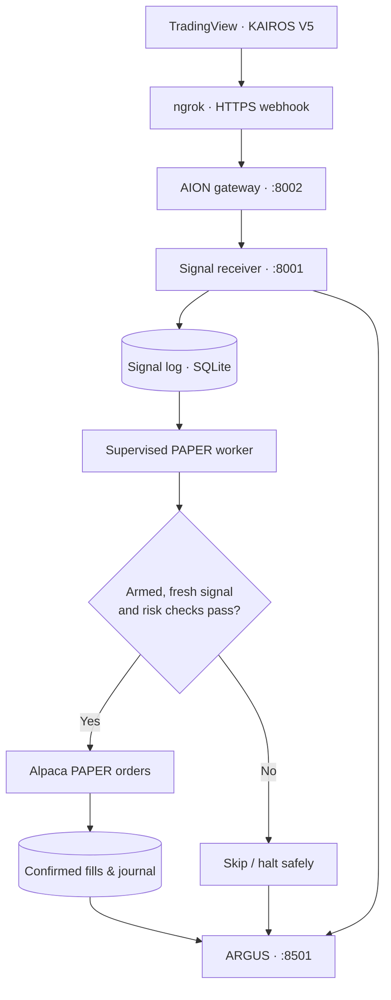
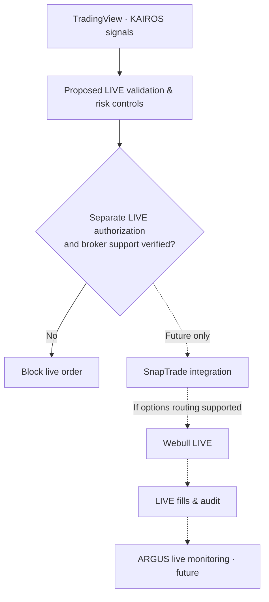

# ARGUS Terminal — AION's Live Trading Monitor

**ARGUS** is the private trading operations and research dashboard for **AION Quant Labs**. It tracks signals from [**KAIROS**](https://github.com/woi-6ix/KAIROS-Lorentzian-ML-Swing-Engine_JXS), monitors execution, and brings market research and backtesting into one interface.

Named after **Argus Panoptes**, the many-eyed guardian of Greek mythology, ARGUS is designed to watch over the trading system. **AION** is the company, **KAIROS** is the strategy, and **ARGUS** is the monitor.

> **Current status (November 2026):** Automated trading uses **Alpaca PAPER only**. SnapTrade/Webull live execution is a proposed future integration, **not deployed**.


## Features

| Feature | What it does |
| --- | --- |
| **Locked Alpaca PAPER controls** | Password-style **control-token unlock** for Pause/Resume, worker status, open positions, individual Close and **Close All + Cancel Orders**. PAPER only. |
| **Live signal monitoring** | Logs TradingView KAIROS alerts, entry/exit intents, rejected events, worker decisions and broker-confirmed fills/P&L. |
| **Backtesting lab** | Historical stock-bar research, KAIROS core-port backtests, TradingView CSV imports and SPY/QQQ/IWM **0DTE quote replay** using real historical bid/ask data. |
| **Stock & ETF screener** | Editable watchlist with historical prices, RSI, EMA20/50, relative volume, volatility and trend labels. |
| **News & sentiment** | Google News RSS headlines scored with **VADER** as positive, neutral or negative. |
| **Market regimes** | Research-only HMM regime classification, GARCH volatility and a STORM-style heuristic. |
| **System diagnostics** | Service health, supervisor status, broker connectivity, kill switch and worker heartbeat. |

### Sentiment research: VADER and IRIS FinBERT

ARGUS currently uses **VADER**, which scores the language in recent financial **headlines** and summarizes the overall tone. It does **not** use FinBERT for its built-in sentiment tab.

My separate project, [**IRIS FinBERT Console**](https://github.com/woi-6ix/IRIS_FinBERT_Console_JXS), goes further: it collects Yahoo Finance news, applies Hugging Face **FinBERT** to classify financial text, combines sentiment with price/return features, and uses **XGBoost** for research forecasts. **IRIS is linked here but is not yet integrated into ARGUS.**

## Trading workflow

### 1. Alpaca PAPER — implemented



KAIROS's SPY 3-minute alerts are validated and logged before the separate worker decides whether to submit a PAPER order. **A successful webhook is not proof of a broker fill.** The worker can attempt SPY 0DTE call/put entries and signal-driven exits, with a **$2,500 total premium limit per entry**, **25-contract cap**, and a **14:45 ET emergency exit attempt**. Stops, failures and uncertain order outcomes require broker verification; exits are not guaranteed.

### 2. SnapTrade / Webull LIVE — planned, not operational



**No real-money routing is enabled.** SnapTrade-to-Webull options execution, broker permissions and additional live-risk controls must be verified and built separately.

## Private access & security

ARGUS runs on **localhost port 8501**, with remote access restricted to authorized devices on a **Tailscale Tailnet (private VPN-like network)**. The sensitive Alpaca PAPER controls have a **second lock**: a locally stored secret entered through a masked input and validated by the server. This is a **control token**, not a separate username/password account.

Only the **TradingView webhook** is publicly reachable through **ngrok**, forwarding to the local gateway on **port 8002**. The receiver (`8001`), dashboard (`8501`), control token and broker credentials are **not publicly exposed**. Keep `.env`, keys, tokens, journals and trading logs out of this public repository.

## Windows operation

The ARGUS dashboard, KAIROS receiver, TradingView gateway and PAPER supervisor run as independent **Windows scheduled tasks**. **ngrok runs as an automatic Windows service**. Closing the browser or PowerShell does not stop these background processes while the PC remains available and signed in.

Check the system before the market opens (weekday **9:15 AM ET** reminder):

```powershell
cd C:\Users\sathw\AION-Execution

Get-Service ngrok | Select-Object Name,Status,StartType
Get-ScheduledTask | Where-Object TaskName -Like 'AION-*' |
    Select-Object TaskName,State

.\.venv\Scripts\python.exe .\aion_paper_supervisor.py status
.\.venv\Scripts\python.exe .\aion_alpaca_paper_algo.py status
```

**Temporary session override — November 10, 2026 only:** Alpaca PAPER new entries may be accepted until **15:30 ET**; the 0DTE emergency exit attempt moves to **15:30 ET** (with exit-order handling to 15:50 ET). The normal **14:45 ET** emergency cutoff returns automatically on **November 11**. This change needs the updated worker and receiver deployed/restarted on the Windows host; it does not change any TradingView Pine session inputs, clear a kill switch, or guarantee fills.

**Safe BTC TradingView test:** with the updated gateway running, run `.\.venv\Scripts\python.exe .\test_tv_dryrun.py`. It posts a fresh synthetic **BITSTAMP:BTCUSD** KAIROS V5 LONG-shaped alert to **`127.0.0.1:8002/tv-webhook-test`**, which authenticates/translates but **never forwards a signal to SQLite or Alpaca**. BTC is accepted **only** on the test endpoint; the real `/tv-webhook` remains SPY-only. This tests payload authentication and mapping, not real TradingView delivery or broker execution.

**Healthy execution requires more than “armed”:** confirm a running worker PID, a **recent heartbeat**, no kill switch, a bound PAPER account and reconciled orders/positions. A connection failure can halt the worker; **Wi-Fi recovery does not automatically clear the kill switch or rearm trading**. Review broker state before manually rearming. Do not replay stale alerts.

Research data is indicative: the stock screener uses Yahoo/yfinance history; ARGUS sentiment is headline-only; the KAIROS backtest core is **not an exact Pine replica**; and 0DTE backtests need genuine historical option bid/ask records. **No verified daily loss cap is implemented.**

## Read-only ChatGPT integration

An optional [**ARGUS read-only MCP connector**](README_ARGUS_READONLY_MCP.md) provides private access to system health, signal logs, worker decisions, PAPER journals, backtests and research through an **OpenAI Secure MCP Tunnel**, when the ChatGPT account/workspace supports custom MCP connections. It cannot arm the bot, submit/close trades or access secrets. **Connection and Windows setup are required; this code is not deployed by a GitHub commit.**

## Documentation

- [**KAIROS strategy repository**](https://github.com/woi-6ix/KAIROS-Lorentzian-ML-Swing-Engine_JXS)
- [**IRIS FinBERT Console**](https://github.com/woi-6ix/IRIS_FinBERT_Console_JXS)
- [**Windows background services**](README_AION_BACKGROUND_SERVICES.md) and [**PAPER supervisor**](README_AION_PAPER_SUPERVISOR.md)
- [**PAPER controls**](README_AION_LTM_PAPER_CONTROLS.md) and [**persistent control token**](README_AION_LTM_PERSISTENT_TOKEN.md)
- [**KAIROS PAPER execution safeguards**](README_AION_KAIROS_V5_2500_PREMIUM.md) and [**Security**](SECURITY.md)

## License

[MIT License](LICENSE), except where separate third-party terms apply.
